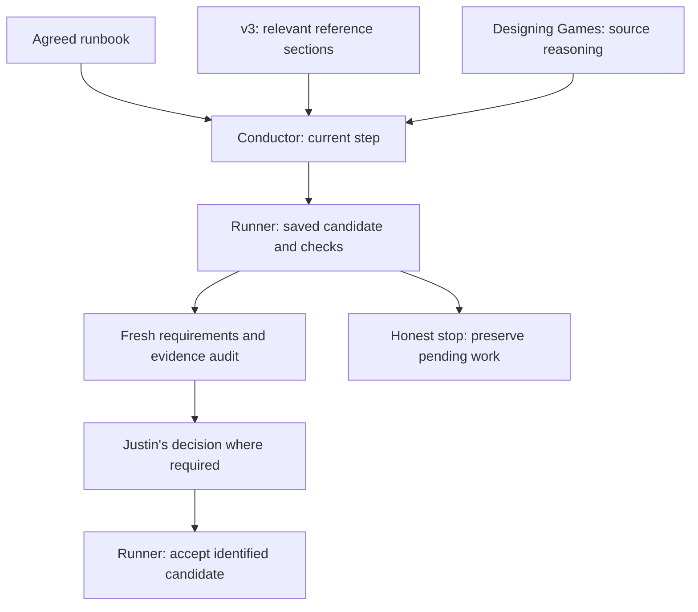

# Game workflow conductor

Use `/game-conductor next|status|resume` in Claude Code or
`$game-conductor next|status|resume` in Codex. Choose one word, for example
`$game-conductor status`. Run `tools/sync-codex-skills.ps1` after skill updates,
then start a fresh session if the client has not rediscovered it.

The Python CLI is the reliable fallback and owns acceptance. It uses Python
3.12+ standard library and Git; this installation was commissioned with Python
3.14.7, Codex CLI 0.163.0-alpha.10.2 and Claude Code 2.1.228. No engine, API key,
paid service or game project is installed by this package.

The shared [runbook and contracts](C:/Dev/Game_Dev_Library/docs/game_workflow/CONTRACTS.md)
link to the preserved guide and the existing Designing Games pilot. Resolve
that library path separately in another runtime. The pilot remains unchanged;
its examples are reference fixtures. No personal pilot skill was installed here.
The conductor invokes the protocol and helper through this existing location.

## v3 reference on demand

For a question needing workflow, engine/adapter, client/tooling, asset-rights or
delivery guidance, or an explicit request to consult v3, open
`docs/AI assisted game dev guide v3.md` under the shared library used by the
project. In this installation it is
[Make AI agents prove your game works (v3)](<C:/Dev/Game_Dev_Library/docs/AI assisted game dev guide v3.md>),
revised 19 October 2026. Resolve the library from the project's adoption record
or setup; before adoption, use its intended `--library` location. This is a
separate supporting source from the preserved revised Page in the contracts.

Use the index below to find the relevant original headings, then read only those
sections and their surrounding qualifications. Include the common setup at the
start of Part B when using an engine appendix. A normal `status` request does not
load v3. For example, locate headings in PowerShell with:

```powershell
$v3Guide = 'C:\Dev\Game_Dev_Library\docs\AI assisted game dev guide v3.md'
rg -n '^#{1,3} ' -- "$v3Guide"
```

Headings inside fenced example code are not section boundaries.

| Question | Sections to retrieve from v3 |
| --- | --- |
| Agent capabilities, limits or evidence claims | Part A: `Evidence: what agents are good and bad at`, retaining the cited studies' qualifications |
| Slice scope, workspace, durable records or autonomy | Part A: `1 Start with the next useful playable` through `4 Give agents room to finish the work` |
| Harness, production input, false passes or candidate evidence | Part A: `5 Commission a small test harness` (including its subheadings) and `6 Run one bounded feature loop` |
| Independent review, debugging or recovery | Part A: `7 Review independently and recover deliberately` |
| Worked example for explaining a staged playable | Part A: `8 Build the example in playable stages`; its orb/gate/tower mechanics remain illustrative |
| Human playtests and interpretation | Part A: `9 Make the human playtest part of development`; also use the existing Designing Games consultation protocol for material design choices |
| Engine selection, setup or adapter commissioning | Part A: `10 Adapt the workflow to the engine`; Part B common setup and only the applicable `B1 Godot 4.7`, `B2 Unity 6.3 LTS` or `B3 Unreal Engine 5.8`; use Part A section 5 for harness duties |
| Client configuration, skills, MCP or review plugins | Part C: applicable `C1 Claude Code`, `C2 Codex` or `C3 codex-plugin-cc (OpenAI's bridge for Claude Code)` |
| Model/effort choices, cost or waiting | Part C: `C4 Suggested defaults to test` and `C5 Cost and waiting` |
| Asset acquisition, generation or provenance | Part A: `11 Track asset rights when assets enter the project`; Part D introduction and applicable `D1 Input-side traps`, `D2 Generator outputs` or `D3 2D and audio` |
| Copyright or distribution disclosures | Part D: `D4 Copyright (US)` and/or `D5 Stores`, with the applicable source links and qualifications |
| Packaging and delivery acceptance | Part A: `12 Accept the artifact you will actually deliver`; consult `D5 Stores` when distribution raises disclosure questions |
| Drafting a task brief or session checklist | Part A: `13 Copyable project instructions` and the relevant brief subheading, `14 Daily operating card`, or `Part E: One-page operating card` |

The agreed runbook, accepted project decisions and applicable instructions remain
authoritative. V3's Part A policy language, `[Policy]` tags, model defaults,
copyable instructions and example mechanics do not adopt themselves. Apply
useful advice within existing authorization; record conflicting recommendations
as proposed amendments for Justin while current scope, check definitions,
review limits and human gates stay in force. Unreal reads and writes retain the
existing serial-connection rule even if another source suggests batching.

Keep v3's `[Documented]`, `[Tested]`, `[Policy]` and `[Unverified]` distinctions.
A cited vendor/practitioner test is not local commissioning. Verify volatile
versions, commands, pricing, licenses and store rules against installed tools or
current primary sources before relying on them; commission recipes before using
them as gate checks. Consulting v3 cannot satisfy execution checks or acceptance.

Record the source path, exact section headings, applicable advice, qualifications
and resulting choice or proposed amendment in the existing task/decision record;
reuse an unchanged consultation instead of adding another status file or approval
loop. V3 citations are distinct from the pilot's validated book consultations.
If v3 is missing, report the source gap and continue unaffected work under the
agreed runbook. Keep any decision or verification that depends on the missing
guidance unresolved. There is no fallback reconstruction or second guide copy.

## Workflow and commands



The adopted runbook defines project duties; the preserved revised Page supplies
its source starter. V3 supports workflow and tooling questions. The pilot
supports design reasoning. The conductor routes work. The runner checks saved
evidence and records acceptance; a required human decision remains Justin's.
Stopping preserves work.

From a real project containing this template's tools:

```powershell
# Prepare only; inspect and configure the proposed steps and actual commands.
python -B tools/game_workflow.py init --project-id my-game --library C:\Dev\Game_Dev_Library
python -B tools/game_workflow.py status
```

Before adoption, `status` reports no agreed runbook. Configure
`docs/process/game-runbook.proposed.json` against the project's actual scope, adapter and
requirements. The source starter cannot pass as an unconfigured project.
Justin then runs this in his own terminal after reviewing the concrete plan:

```powershell
python -B tools/game_workflow.py adopt --library C:\Dev\Game_Dev_Library --proposal docs/process/game-runbook.proposed.json --reason 'Initial reviewed project scope and commissioned checks'
```

During an authorized step:

```powershell
python -B tools/game_workflow.py next
python -B tools/game_workflow.py verify slice --builder-session actual-builder-session-id
# Fresh reviewer independently inspects the candidate; at required gates:
python -B tools/game_workflow.py reproduce slice check-id --reviewer-session actual-reviewer-session-id
python -B tools/game_workflow.py audit slice --file work\independent-audit.json
# Justin only, after playing this identified candidate, when the step requires it:
python -B tools/game_workflow.py human experience --notes 'Actual observations and decision'
python -B tools/game_workflow.py accept slice
python -B tools/game_workflow.py stop --reason budget --note 'Work preserved; next action is ...'
python -B tools/game_workflow.py resume
```

Use the actual step and check IDs. Consultations are validated with:

```powershell
python -B tools/game_workflow.py consultation docs\decisions\decision.json --library C:\Dev\Game_Dev_Library
python -B C:\Dev\Game_Dev_Library\docs\designing_games_pilot\tools\book_reference.py search 'prototype'
python -B C:\Dev\Game_Dev_Library\docs\designing_games_pilot\tools\book_reference.py page --printed 321 --end 321
```

`.workflow/state.sqlite3` and its retained run directories are the sole execution
store. Preserve them when moving a project; Git ignores them. `STATE.md` stays
the concise game handoff, linking to actual run IDs. `.agent/CONTINUITY.md` in the
template records tooling maintenance only; `new-game.ps1` excludes it. Historical
step acceptance names an older candidate, not proof of later edits. `status`
distinguishes this from current-candidate acceptance. Changes to scope or check
definitions need reasoned adoption and fresh review; they do not inherit approval.

Claude hooks guard the named file tools and direct Unreal tool names; shell
writes and other clients bypass them. Stop hooks allow all honest stops and
never accept work. The runner revalidates saved inputs and results at gates.
The local ledger and terminal checks are cooperative controls, not authenticated
identity or a boundary against a same-user adversary. See the shared contracts
for exact coverage, external/ignored-input limits and the Unreal adapter contract.
Live skill dispatch, actual engine adapters and human experience require their
own commissioning; the test suite uses explicitly simulated fixtures.

Commission or recheck shared tooling from `C:\Dev\Game_Dev_Template`:

```powershell
python -B -X utf8 tools/test_game_workflow.py
python -B C:\Dev\Game_Dev_Library\docs\designing_games_pilot\tools\book_reference.py validate
python -B C:\Dev\Game_Dev_Library\docs\designing_games_pilot\tools\book_reference.py self-test
```

Fixtures are created only in ignored `work/workflow-fixtures/`, checked before
cleanup and removed after each test. No game or existing player save is touched.
Set `GAME_DEV_LIBRARY` for the tests in a different installation. Cooperating
Unreal wrappers share an OS temp queue by default; sandbox commissioning may
set `GAME_WORKFLOW_QUEUE_DIR` to one shared writable directory for all callers.

Invocation and hook contracts were checked against the installed versions and
official [Codex skill docs](https://learn.chatgpt.com/docs/build-skills),
[Claude skills](https://code.claude.com/docs/en/skills) and
[Claude hooks](https://code.claude.com/docs/en/hooks). `/game-conductor` is a
project skill; no `/codex:...` plugin namespace is claimed.
