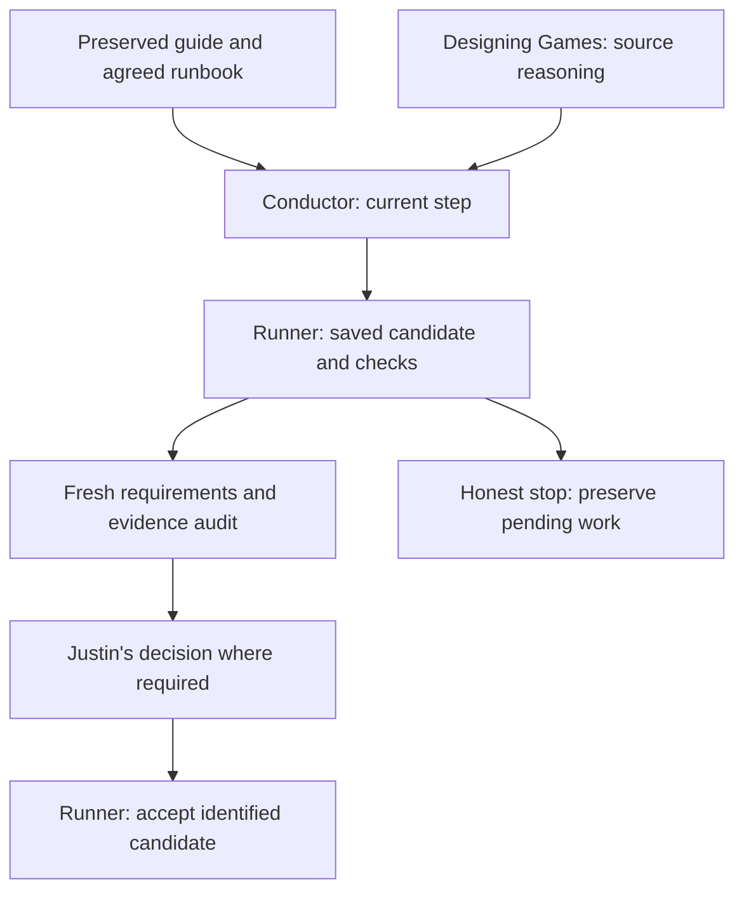

# Game workflow conductor

Use `/game-conductor next|status|resume` in Claude Code or
`$game-conductor next|status|resume` in Codex. Choose one word, for example
`$game-conductor status`. Run `tools/sync-codex-skills.ps1` after skill updates,
then start a fresh session if the client has not rediscovered it.

The Python CLI is the reliable fallback and owns acceptance. It uses Python
3.12+ standard library and Git; this installation was commissioned with Python
3.14.7, Codex CLI 0.163.0-alpha.10.2 and Claude Code 2.1.228. No engine, API key,
paid service or game project is installed by this package.

The shared [runbook and contracts](C:/Dev/Game_Dev_Library/docs/game_workflow/CONTRACTS.md)
link to the preserved guide and the existing Designing Games pilot. Resolve
that library path separately in another runtime. The pilot remains unchanged;
its examples are reference fixtures. No personal pilot skill was installed here.
The conductor invokes the protocol and helper through this existing location.



The guide defines workflow duties. The pilot supports design reasoning.
The conductor routes work. The runner checks saved evidence and records
acceptance; a required human decision remains Justin's. Stopping preserves work.

From a real project containing this template's tools:

```powershell
# Prepare only; inspect and configure the proposed steps and actual commands.
python -B tools/game_workflow.py init --project-id my-game --library C:\Dev\Game_Dev_Library
python -B tools/game_workflow.py status
```

Before adoption, `status` reports no agreed runbook. Configure
`docs/process/game-runbook.proposed.json` against the project's actual scope, adapter and
requirements. The source starter cannot pass as an unconfigured project.
Justin then runs this in his own terminal after reviewing the concrete plan:

```powershell
python -B tools/game_workflow.py adopt --library C:\Dev\Game_Dev_Library --proposal docs/process/game-runbook.proposed.json --reason 'Initial reviewed project scope and commissioned checks'
```

During an authorized step:

```powershell
python -B tools/game_workflow.py next
python -B tools/game_workflow.py verify slice --builder-session actual-builder-session-id
# Fresh reviewer independently inspects the candidate; at required gates:
python -B tools/game_workflow.py reproduce slice check-id --reviewer-session actual-reviewer-session-id
python -B tools/game_workflow.py audit slice --file work\independent-audit.json
# Justin only, after playing this identified candidate, when the step requires it:
python -B tools/game_workflow.py human experience --notes 'Actual observations and decision'
python -B tools/game_workflow.py accept slice
python -B tools/game_workflow.py stop --reason budget --note 'Work preserved; next action is ...'
python -B tools/game_workflow.py resume
```

Use the actual step and check IDs. Consultations are validated with:

```powershell
python -B tools/game_workflow.py consultation docs\decisions\decision.json --library C:\Dev\Game_Dev_Library
python -B C:\Dev\Game_Dev_Library\docs\designing_games_pilot\tools\book_reference.py search 'prototype'
python -B C:\Dev\Game_Dev_Library\docs\designing_games_pilot\tools\book_reference.py page --printed 321 --end 321
```

`.workflow/state.sqlite3` and its retained run directories are the sole execution
store. Preserve them when moving a project; Git ignores them. `STATE.md` stays
the concise game handoff, linking to actual run IDs. `.agent/CONTINUITY.md` in the
template records tooling maintenance only; `new-game.ps1` excludes it. Historical
step acceptance names an older candidate, not proof of later edits. `status`
distinguishes this from current-candidate acceptance. Changes to scope or check
definitions need reasoned adoption and fresh review; they do not inherit approval.

Claude hooks guard the named file tools and direct Unreal tool names; shell
writes and other clients bypass them. Stop hooks allow all honest stops and
never accept work. The runner revalidates saved inputs and results at gates.
The local ledger and terminal checks are cooperative controls, not authenticated
identity or a boundary against a same-user adversary. See the shared contracts
for exact coverage, external/ignored-input limits and the Unreal adapter contract.
Live skill dispatch, actual engine adapters and human experience require their
own commissioning; the test suite uses explicitly simulated fixtures.

Commission or recheck shared tooling from `C:\Dev\Game_Dev_Template`:

```powershell
python -B -X utf8 tools/test_game_workflow.py
python -B C:\Dev\Game_Dev_Library\docs\designing_games_pilot\tools\book_reference.py validate
python -B C:\Dev\Game_Dev_Library\docs\designing_games_pilot\tools\book_reference.py self-test
```

Fixtures are created only in ignored `work/workflow-fixtures/`, checked before
cleanup and removed after each test. No game or existing player save is touched.
Set `GAME_DEV_LIBRARY` for the tests in a different installation. Cooperating
Unreal wrappers share an OS temp queue by default; sandbox commissioning may
set `GAME_WORKFLOW_QUEUE_DIR` to one shared writable directory for all callers.

Invocation and hook contracts were checked against the installed versions and
official [Codex skill docs](https://learn.chatgpt.com/docs/build-skills),
[Claude skills](https://code.claude.com/docs/en/skills) and
[Claude hooks](https://code.claude.com/docs/en/hooks). `/game-conductor` is a
project skill; no `/codex:...` plugin namespace is claimed.
